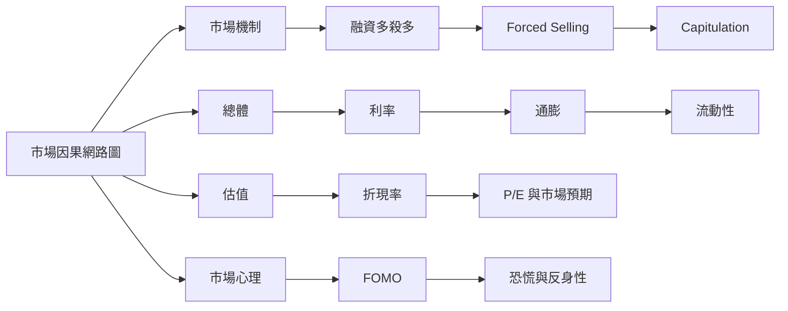

# finance-notes

以圖解為主的金融市場知識庫。

這個 repo 的目標不是蒐集零散名詞，而是建立一套可以追蹤 **「什麼導致什麼」** 的市場因果模型，幫助理解市場機制、籌碼、估值、總體環境與投資心理之間如何互相影響。

## 核心地圖

- [市場因果網路圖](maps/market-causal-map.md) — 從總體環境、基本面、估值、資金部位、市場心理一路連到價格與回饋迴圈。

## 原則

- **Diagram first**：優先用 Mermaid 圖解，再補必要文字。
- **Causal, not descriptive**：不要只寫「是什麼」，要寫「為什麼會發生、會導致什麼」。
- **Mechanism over slogan**：市場術語要拆成中間傳導機制。
- **Evidence-aware**：可觀察的數據與指標要能回頭驗證因果假設。
- **Explicit invalidation**：標註什麼情況下這條邏輯可能失效。

## 預計擴充

