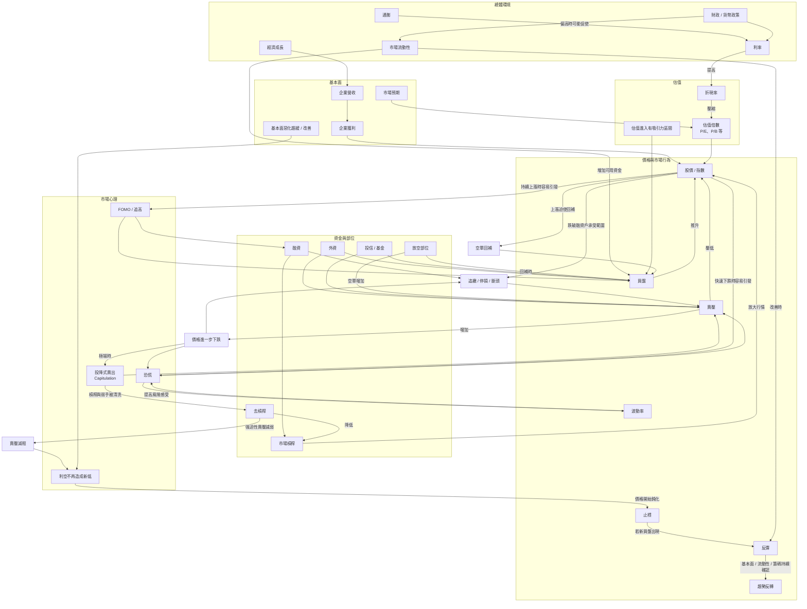
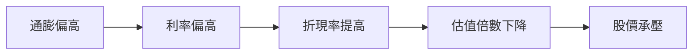
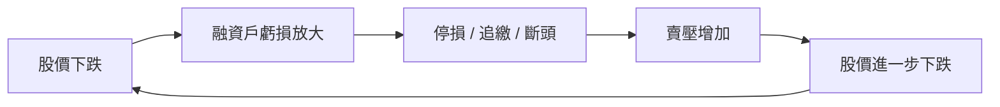
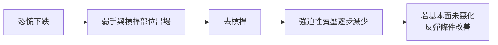
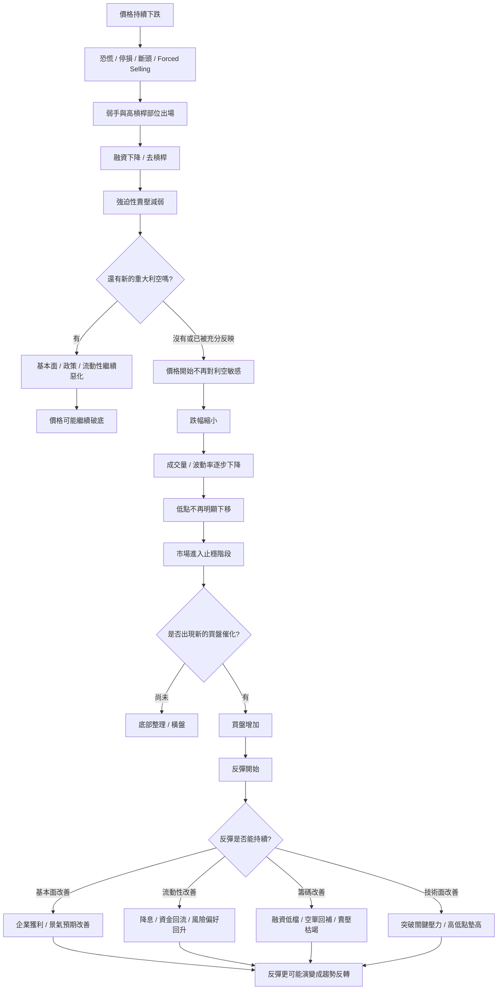
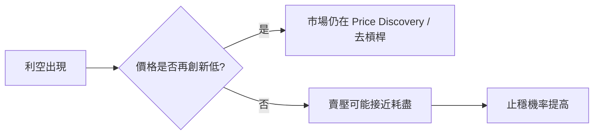
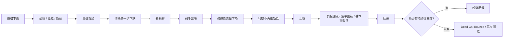
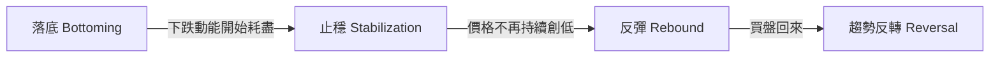

# 市場因果網路圖

這份圖是 `finance-notes` 的核心入口之一，用來回答一個問題：**什麼因素會透過什麼機制，影響市場價格、風險與籌碼？**

> 箭頭表示「常見影響方向」，不是保證結果。市場中的因果通常會被時間、估值、政策、流動性與市場預期共同改變。

## 目前先抓住的核心因果鏈

### 1. 利率 → 估值

### 2. 融資 → 多殺多

### 3. 恐慌 → 去槓桿 → 賣壓減弱

### 4. 落底 → 止穩 → 反彈 → 反轉

### 5. 利空不再創新低

### 6. 下跌迴圈如何切換成落底迴圈

## 落底、止穩、反彈、反轉不是同一件事

- **落底 Bottoming**：賣壓與去槓桿機制逐步耗盡的過程。
- **止穩 Stabilization**：價格開始不再持續創低，但不代表已經轉多。
- **反彈 Rebound**：短期買盤開始大於賣壓，價格向上修復。
- **趨勢反轉 Reversal**：基本面、流動性、籌碼或價格結構開始支持更持續的上升趨勢。

> 關鍵觀念：**落底不是因為「跌很多了」，而是因為導致下跌的賣壓機制開始耗盡。**

## 使用方式

之後每一個主題都應該盡量回答：

1. **Trigger**：什麼事情先發生？
2. **Mechanism**：中間透過什麼機制傳導？
3. **Observable evidence**：市場上可以觀察什麼資料？
4. **Feedback loop**：是否存在正回饋或負回饋？
5. **Invalidation**：什麼條件下這條因果鏈不成立？

未來新增的主題頁，應該回連到這張因果網路，而不是成為孤立筆記。
